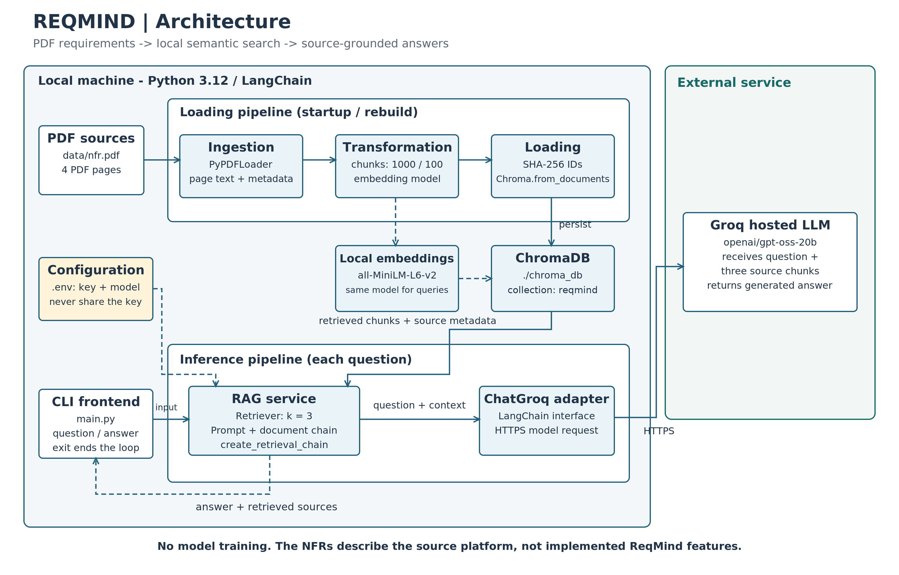
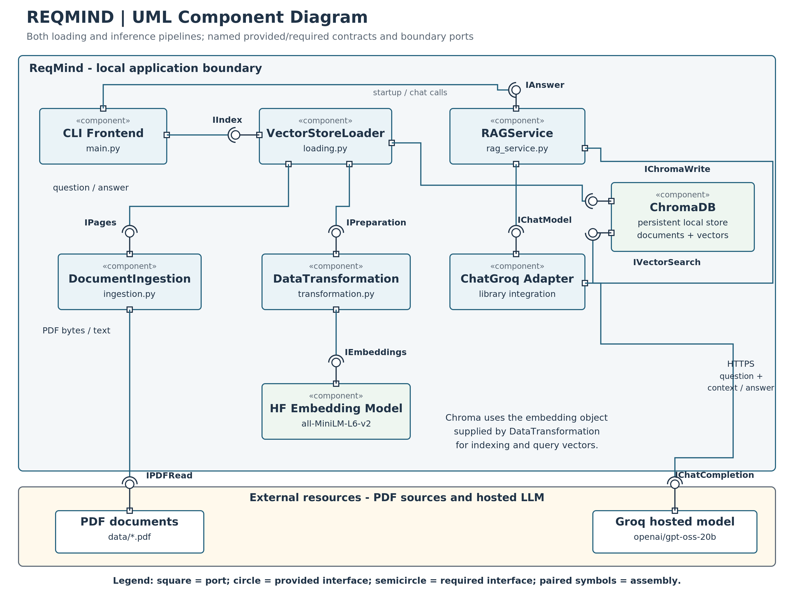

# ReqMind

Ask a question about a long requirements PDF and get an answer, along with the passages it came from.

ReqMind is a small retrieval-augmented generation (RAG) chatbot that runs in the terminal. I built it on my own for an AI Systems Design course in Fall 2026. Requirements documents are long and dense, and when someone asks "what's the response-time requirement?", the useful answer is the requirement *and* the page it lives on, so the person can check it.


## How it works

There are two pipelines.

**Loading (runs at startup).** `ingestion.py` reads every PDF in `data/` page by page and keeps the file name and page number. `transformation.py` splits the pages into 1,000-character chunks with a 100-character overlap and creates a local Hugging Face embedding model (`all-MiniLM-L6-v2`). `loading.py` gives each chunk a SHA-256 ID and stores the chunks and their vectors in ChromaDB, so re-running the pipeline overwrites the same entries instead of adding duplicates.

**Answering (runs for every question).** `rag_service.py` retrieves the 3 chunks closest to the question and sends them, with the question, to an LLM hosted on Groq. The prompt tells the model to answer from that context only, to quote requirement IDs such as `NFR-01` when they appear, and to say so when the document doesn't contain the answer. `main.py` prints the answer and then the source chunks with their file name and page.





The editable source for both diagrams is `diagrams/ReqMind_Design.drawio` (open it at [app.diagrams.net](https://app.diagrams.net)).

## Run it

You need Python 3.12 and a free Groq API key from [console.groq.com](https://console.groq.com).

```bash
python3 -m venv .venv
source .venv/bin/activate
pip install -r requirements.txt
cp .env.example .env
```

Open `.env`, paste your key into `GROQ_API_KEY`, put a requirements PDF in `data/`, then start the chatbot:

```bash
python main.py
```

Type a question, or `exit` to quit. The first run downloads the embedding model, so it takes a little longer.

## Design choices and trade-offs

- **k = 3.** Three chunks keep the prompt short and the answer fast. The cost is that a detail sitting in a fourth chunk gets missed, so a question that spans several sections can get an incomplete answer.
- **1,000 / 100 chunking.** Big enough to hold a full requirement with its ID, small enough that one chunk rarely mixes unrelated requirements. The overlap stops a requirement from being cut in half at a chunk boundary.
- **Local embeddings, hosted LLM.** Embedding runs on your machine, so the document is only sent to Groq three chunks at a time, never as a whole.
- **Grounded answers.** Showing the source chunks under every answer lets the reader check the model instead of trusting it.

## Limitations

- The vector store is rebuilt every time the program starts, which is fine for one document and slow for many.
- There's no automated evaluation set yet, so there's no score for answer quality.
- It's a command-line tool; there's no web interface.

## Project structure

```
main.py              terminal chatbot (entry point)
config.py            settings: model names, chunk size, k, paths
ingestion.py         PDF loading
transformation.py    chunking + embedding model
loading.py           SHA-256 chunk IDs + ChromaDB storage
rag_service.py       retriever + prompt + Groq LLM chain
data/                put your PDFs here (ignored by git)
diagrams/            architecture and UML component diagrams
```
